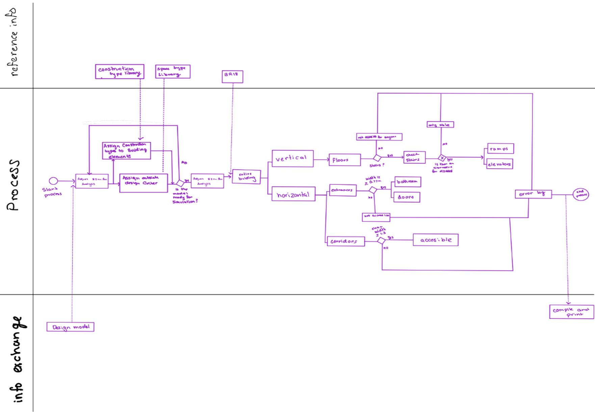
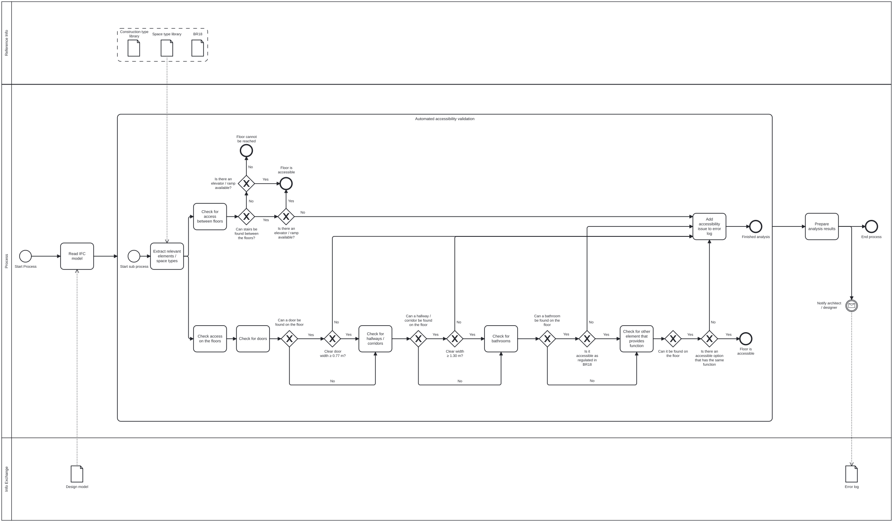

# A2

## A2a: About your Group
-	Pauline - 2
-	Gabriel - 2
-	Charlotte - 2

Our group's focus area is Architecture and we have the manager's role.

## A2b: Identify Claim
For this assignment, we have chosen to review the report from Building # 2601.

The claim we want to investigate is whether the building can be considered well-functioning and accessible not only for able bodied users, but also for users with physical functional disabilities. These are people who have reduced mobility, cerebral palsy, and are paralyzed to name a few. We want to check whether physical functional disabled users have access to the same main facilities and freedom of movement within the building as other users. 

More specifically, we want to investigate whether the building provides equal access between floors, whether doors are sufficiently wide enough for wheelchair users, and whether accessible bathrooms are provided where regular bathrooms are made available. For example, if able bodied users can move between the floors using stairs, we want to check whether there is also an accessible alternative such as an elevator available. Similarly, in movement through doors and hallways we want to check whether or not they accommodate wheelchair users.

We have selected this claim because accessibility is important, and in the proposed renovations, often overlooked features. It is an important part of making a building functional for all its users. 

A building may appear well functioning from a general architectural perspective, while there is significant barriers for people with reduced mobility. By checking accessibility directly in the IFC model, and comparing the relevant building elements with accessibility requirements, we seek to identify whether the design provides equal access or whether important accessibility features need to be implemented.

## A2c: Use Case
To check our claim, we would analyze the IFC model against relevant BR18 accessibility requirements, mainly found in § 48 - § 62. These specifies that users should be able to independently reach, enter and use the building’s functions, allowing us to assess whether disabled users have equal access to the same facilities as able bodied users.

We would do so by comparing relevant IFC elements. For example, if an IFCStair connects to a set of floors, we would check for an accessible alternative, such as an elevator represented by IFCTransportElement. We would also assess doors, hallways and bathroom facilities using more specific BR18 requirements where needed.

The claim should be checked during the design process, while changes to the building layout and accessibility solutions can still be made, allowing changes to be made before the design is finalized or construction begins.

The claim relies mainly on information obtained from the IFC design model, together with external regulatory information (BR18).

The relevant phase is therefore, as mentioned before, the design phase, since the purpose of the tool is to evaluate whether the proposed building design provides sufficient accessibility before it is constructed.

The primary BIM purpose is to analyze, seeing as information in the IFC model is analyzed to determine whether the accessibility requirements are satisfied. The results would then also be communicated to the architect or other designers, ensuring awareness of the problem.

The BIM use case closest to ours would be 12: Code Validation – it is in fact so similar, one might say they are the same. Our tool, however, has a different scope and implementation, seeing as we are focusing solely on accessibility in relation to BR18 regulations, and not on things such as fire safety or structural rules which the use case also easily could be used for.

With the following BPMN diagram, we want to show our initial thoughts on the entire process, from receiving the design model to reporting the accessibility problems.

## A2d: Scope the use case
Our tool will focus on the automated accessibility check of the IFC model. The tool will therefore not cover the entire design or code validation process, but only the part where accessibility related IFC information is given, which will be extracted and checked against the corresponding BR18 requirements and reported back to the architect / designer.

The architect / designer will provide the tool with the IFC model and review the results, while decisions on if and how the design should be changed remain outside of the scope.

## A2e: Tool Idea
Our idea is to develop a tool that checks accessibility in a given IFC model against the regulations found in BR18. The tool would extract relevant elements such as IFCStair, IFCDoor and specified spaces such as hallways and bathrooms, and check whether an accessible counterpart was also provided. If not, the tool will add this error to a list, which in the end will be printed as part of a report covering the entire building, thereby making the designer aware of said problem.

The business value is that accessibility checks could be performed faster and more consistently during the design phase. This could help architects and designers identify problems earlier, reducing the risk of possible redesign or redoing once the project is in a later phase, or possibly has been completed.

The societal value is that the tool could help make sure that more buildings can be used independently by users with disabilities. By making it an OpenBIM tool, we are making sure that the checks are less dependent on specific BIM software, allowing it to be used across different IFC models and projects. 

After working further with the tool and clarifying its purpose and scope, we have updated the initial BPMN diagram shown in A2c. The revised diagram better reflects how we now intend the accessibility tool to work, while focusing more clearly on the parts of the process the tool will perform.

## A2f: Information Requirements
To perform the checks needed, the tool needs to extract information about stairs, elevators, doors, hallway widths and bathroom spaces – and maybe more. This information should be found in the model, as it is an IFC type. It would do so by using the prompt: 

**model.by_type(*“IFC type you want to locate”*)**

For example, if “IFCStair” is located within the model, the tool will proceed to look for “IFCTransportElement” which is how an elevator is defined. If an elevator cannot be found, it will add this information to an open string as an error message. After this, it will go on to the next type. 

For the width of the door, we will use the information *OverallWidth* which is an attribute to IFCDoor, which represents the width of the door opening. We will then compare this to the 0,77 m. required by BR18, and if it is narrower than this, we will add it to the open string.

IFCspaces will be checked by identifying all the space through IFCSpaceType which would allow use to determine if the spaces are hallways, rooms, and bathrooms. 

At the end of the analysis, the full list of possible errors will be printed to the user, and they will get an overview of where action is needed.

The main things we need to learn are how to do the thing with IFCSpaces that we haven’t yet described. We also need to learn how to determine which floors a stair or elevator connects and how to check the width of a IFCSpace such as a hallway using ifcOpenShell.

## A2g: Identify appropriate software license
We would choose the GPL-3.0 license, seeing as the project contains source code. We do this because it allows others to use, improve and redistribute the tool, while keeping newer versions under the same open license.
